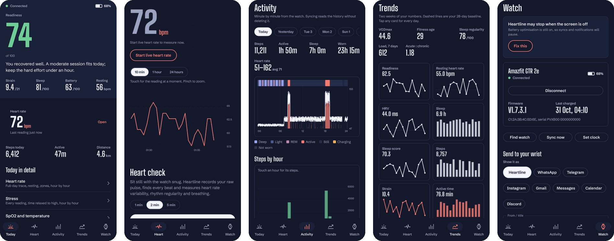
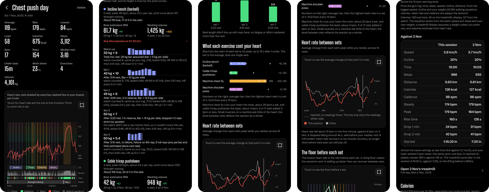
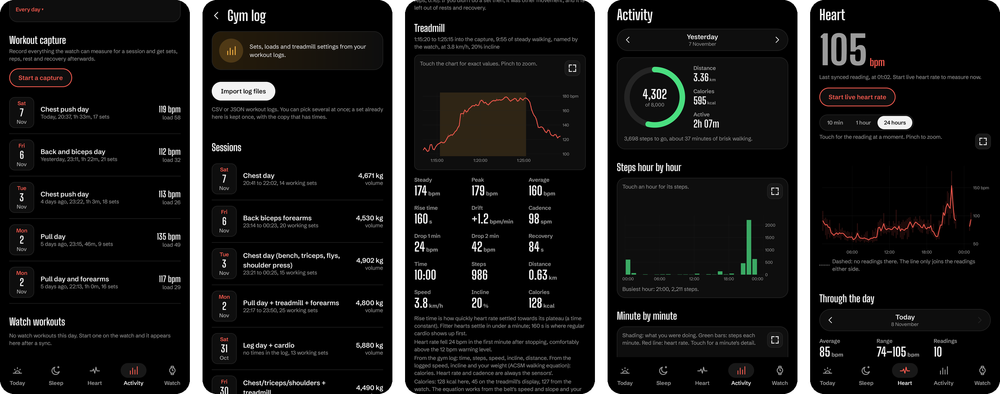

# Changelog

Every Heartline release, newest first. Each entry is also the release's notes on GitHub, where its APK is.

## 0.13.0 (2026-11-28)

### Changed

- **Daytime heart checks wait for a still wrist and stop when they have enough.** A daytime check now watches your wrist for its first 20 seconds and stops there if it was still for under 6 of them, trying again 10 minutes later. These short scouts don't count towards the three tries before the hour's pause, so a morning of typing costs a 20 s scout every 10 minutes instead of three 2-minute checks back to back. A check that goes on stops as soon as it has 50 seconds of clean beats, or as soon as the 45 it needs is out of reach. On 191 recorded daytime checks, the scout would have ended 131 after 20 s and lost 3 of the 29 that passed, and the checks that passed had enough beats at a median 74 s instead of 120. The first one on the phone stopped at 62 s with a clean reading. Overnight checks are unchanged.
- **The event log says how long each daytime check recorded and why it ended**, and the app keeps both with the sample.

## 0.12.3 (2026-11-28)

### Fixed

- **Short sleep stages line up with their bars.** A brief stage, such as a waking of a minute or two, is now drawn at its true width as a thin line on its bar, instead of a widened pill that spilled past the next block and left the bars off its edges. Only a stage too thin to see at all is widened, evenly about its middle.

## 0.12.2 (2026-11-28)

### Changed

- **Sleep stages are drawn as a watch draws them.** Each block now sits in a see-through rim of its colour, and the bar between two stages flows out of one rim into the next with curved joins. The blocks are a little slimmer, and touching a stretch lights its own rim and joins while the rest fade back.

## 0.12.1 (2026-11-28)

### Changed

- **The sleep stages chart is cleaner.** The soft glow between stages is gone. Each change of stage is now one bar that runs from the top of the upper block to the bottom of the lower one, fading from one stage's colour to the next, drawn over the blocks' ends so no seam shows.

## 0.12.0 (2026-11-28)

### Added

- **Every Today tile has a small graph of its data.**
  - Heart: the last 24 hours in ten-minute means.
  - Steps and stress: today's hours as bars, stress coloured by band.
  - Blood oxygen: the last day's readings as dots, red under 92%.
  - Temperature: the last 24 hours in half-hour means.
  - Sleep: keeps its small stages chart.
  - The steps percentage moved next to the goal.

### Changed

- **Sleep stages read as episodes, as a watch shows them, with no stray lines.** REM and deep stretches a few minutes apart are drawn as one episode (up to 12 minutes of other sleep between), stretches under 5 minutes join their neighbours, and wakings are never folded away. Blocks are joined by soft ribbons instead of thin lines, and the dotted row lines are gone. "Every minute" still shows exactly what the watch scored, and the totals always count every minute.

### Fixed

- **The live heart-check chart's "0" no longer sits on the movement limit's label** when a big move rescales the lane.

### For developers

- The 1,280-line workout screen file is split by page (capture start, capture page, capture sections, watch workout page). AGENTS.md maps where each lives.
- A test checks that every health topic the AI can ask for answers.

## 0.11.0 (2026-11-28)

### Added

- **Rides inside a session.** Cycle part of a Run / walk session and the ride is found by itself, from a Cycling workout on the watch or a minute or more at bike speed on the phone's GPS. It gets its own Riding section: distance, moving time, average speed, best 5 minutes and 30 seconds, stops, climbing, heart rate while riding, how far each heartbeat carried you, speed through the ride with the stops shaded, and each kilometre's speed and heart rate. The route and the timeline colour it blue, its calories are counted apart, and the runs, walks and laps leave it out. The 22 Nov session now reads: 7.65 km in 32:16 of riding, 12.4 km/h moving, 12 stops, 64 m of climbing.
- **A Cycling workout on the watch** gets the same ride section, and its distance is never "corrected" from steps (a ride has hardly any).
- **Scrub through a route.** Under every map, drag through the session's time (or press play) and a marker follows the route, with the time, distance so far, speed, heart rate and altitude at that moment; what's still ahead fades. Full screen, the map follows the marker.
- **Phone GPS or watch GPS.** When the phone recorded alongside the watch, switch the map between the two tracks or show both, the watch's dashed over the phone's, with how far apart they were at each moment.
- **Colour the route** by activity (running, walking, riding), heart rate, speed or altitude, with its scale; kilometre marks are numbered along it.
- **A live chart during heart checks.** The pulse on ECG paper with every beat marked, used or set aside, moving stretches shaded, the wrist's movement underneath, and heart rate, beats used, clean time, HRV and movement so far; the last 10 seconds or the whole check. It shows on the heart check page and under a running automatic check.
- **A new sleep stages chart.** Awake, REM, light and deep as rows with each one's total, every stretch a rounded block in its stage's colour joined to the next, and the times along the bottom; touch it for the stretch, heart rate and SpO2 at that minute. Stretches of a stage under 4 minutes with the same stage either side are folded in (wakings never are); "Every minute" shows exactly what the watch scored, and the totals always count every minute. The Today tile shows a small one.
- **What's sent to the AI.** Under AI insights (and AI models), a page shows the instructions, the message and every section of your data exactly as the model gets them, gathered fresh, with a button to copy it all.

### Changed

- **Insights you ask for go once to the main model**: no retries, no fallbacks, so they answer or fail quickly. If one fails, the page says why and offers the other models right there. The daily run keeps the whole chain and its retries.
- **Heart checks see the wrist turning.** Movement was measured from the size of the acceleration, which stays near 1 g while the hand turns, so a turning wrist looked still and its beats were used. It now counts every axis, and beats are set aside from 0.015 g, where on 374 recorded checks beats stopped behaving like still ones. The beat finder takes its threshold and reference beat from still stretches only.
- **An automatic check counts as clean** with 45 seconds of clean beats and 70% of the beats found while still, wherever they fall in the check (45 s gave HRV within 6% of the whole check's on real recordings). Overnight, clean checks went from 158 to 163 of 183; by day from 27 to 28 of 191, each with cleaner HRV. The write-up is research/heartcheck-motion.md: recovering beats while the hand moves isn't possible with this sensor, and the SpO2 mode adds no extra light channel.

### Fixed

- **The watch reconnects when Android's Bluetooth restarts under the app.** From 22 Nov 18:51 to 24 Nov 01:50 IST nothing synced: the phone's Bluetooth service had restarted, the old connection never said it was closed, and Heartline kept sending into it (every sync, notification and check failed). A dead connection, or three requests in a row that can't start, now closes it and connects again. The watch's minute history and temperature came back afterwards; that night's SpO2 did not.
- **Daily insights now get your data.** Since the health lookups were merged into one, the insights went on asking for the old names and were sent almost nothing but heart checks, which is why they said there was no HRV since 10 Nov. They now get readiness, trends, both nights' sleep, HRV (overnight, daytime and heart checks), heart rate, activity, stress, SpO2, temperature and workouts, and a test checks every section answers.
- **A session with a ride no longer reads as a gym session** (its arm movement on the handlebars looked like 14 sets), in the list and on its page.
- **The AI's data has readable headings** (HRV, SpO2 and temperature, workout captures), and the What's sent page says "1 line", not "1 lines".
- **Captures with the phone's GPS list their watch workouts again**, all of them, including those that started after the capture's own analysis.

## 0.10.0 (2026-11-21)

### Added

- **One Run / walk switch for a capture.** Turn it on and the whole session is read on foot: the walk there, runs and walks, laps of a loop and the walk back, however often you change the workout on the watch. The phone's GPS switch sits under it. With it off, choose Gym or Other. Laps are only looked for in a Run / walk session. Captures labelled Run or Walk before this still read as on foot.

### Fixed

- **A walked lap whose GPS wandered is no longer dropped.** On 21 Nov the fifth lap (walked, 18:21 to 18:29 IST) traced 1,278 m on the watch's GPS against about 860 m for the others, and any lap a quarter longer than the rest threw out the whole set, so the session showed 4 laps. A long lap now counts when it went as far round the loop as the others did, in no more than 2.5 times their time. The 21 Nov session now reads: run 6:20, walk 7:19, walk 8:24, run 6:21, walk 8:50.
- **A stop at the lap point no longer loses the lap.** Which way you were going at a pass is now taken from the last 20 m of your track, not a few seconds either side, which pointed anywhere while you stood still to end the workout there.
- **Missed laps aren't invented inside a wandered one.** A missed pass is filled in only when the gap took far longer than a lap and what's left after it is most of a loop.
- **The walk home shows again** as the end of the laps when the GPS lost its fix on it: a part-lap of 2 minutes or more is listed with its time when its distance is unknown.

## 0.9.0 (2026-11-21)

### Added

- **Laps on your earlier run captures.** A Run or Walk capture without the phone's GPS now takes its route, distance and laps from the watch workouts inside it. On the three lake runs so far: 14 Nov, 4 laps of about 783 m; 19 Nov, 5 laps of about 727 m; 21 Nov, 4 laps of about 791 m, each with its running, walking, pace and heart rate.
- **Captures and watch workouts link both ways.** A run capture lists the watch workouts inside it, each opening its own page, and each workout page links back to "Part of your run capture". Workouts the watch handed over after the capture was analysed (it holds them back while one runs) now show up too, with their corrected distances.
- **A full-screen map.** Tap Full screen, or double-tap the map, for a map you can pinch, pan and zoom, with + and − buttons. A chip per lap (and the start and end) fades the rest of the route, fits the view to that lap and shows its time, distance, pace, running, walking and heart rate. The lap point is marked with a ring.
- **Let Zepp connect for 15 minutes.** On the Watch page, Heartline lets go of the watch so the Zepp app can sync or change a setting, then takes it back by itself. "Reconnect now" ends it early, "15 min more" extends it. A capture or heart check that is recording stops first.

### Changed

- **Run pages are no longer a gym page.** On a Run or Walk capture, the strip under the heart rate shows running, walking and standing (no lifting or rest), calories split into running, walking and standing, and the per-walk blocks with set and recovery figures, the "by exercise" bars and the gym notes are gone. The capture list says "run and walk" instead of "1 set".
- **The phone GPS switch says what it does.** A workout started on the watch only reaches Heartline once it has ended, so the phone's GPS can't follow it: start the capture in Heartline before you set off.

### Fixed

- **Daily step goal.** The box was empty though 8,000 was in use, and it sent each number you typed that was in range, so typing 10000 first set the watch's goal to 1,000. It now shows the goal and sends it once, when you press Done or leave the box, and says the range.
- **Lap distances on wandered watch tracks.** Within a workout whose distance comes from steps, a moment standing now counts as no distance rather than unknown, so a short stop no longer blanks a whole lap's distance.
- The full-screen map no longer covers its own title and close button.

## 0.8.0 (2026-11-21)

### Added

- **Runs and walks with the phone's GPS.** A capture can now be a Run or a Walk, with a switch to record the phone's GPS too. The phone records the route once a second (it keeps going with the screen off) and keeps to the path where the watch's track can wander, as it did on 19 and 21 Nov. Distance, pace, the route on the map and each run's and walk's distance come from it, both on the capture and on the watch's own workout over the same time, which says so. While you go, the capture shows the distance, the pace over the last 30 seconds and the laps so far. Start the capture in Heartline before you set off: a workout started on the watch only reaches Heartline once it has ended (the watch refuses every transfer while one runs), too late for the phone's GPS. The first time, Heartline asks for precise location.
- **Laps of a loop.** Heartline finds the point on your route you pass most often, going the same way, and splits the session into laps. Each lap has its time, distance, pace, fastest 30 seconds, how much was running and walking with the pace of each, cadence, step length and heart rate; tap one for its runs and walks one by one. Above them: the fastest and slowest lap, how even the laps were, whether the last ones were slower, how much of the first and last lap was running, and how far each heartbeat carried you. Two whole laps are needed; a walk out and back, or home a different way, isn't taken for laps.
- **Laps on earlier watch workouts too.** Without the phone's GPS, laps come from the watch's own track. Where it wandered, the moments it passed the lap point still mark the laps and their distances come from your steps: on 21 Nov the lake laps came to 725, 677, 743 and 791 m, against a 745 m loop, where the watch's track made it 5.00 km in all.

### Changed

- **Walk** joins Gym, Run and Other when starting a capture.

## 0.7.2 (2026-11-21)

### Fixed

- **Workouts done while the watch was busy now sync within minutes.** During a workout the watch refuses every transfer, and Heartline was reading that as "nothing new" and waiting an hour. On 21 Nov all three hourly syncs fell inside a walk, a run and a walk, so none of the three reached the phone until a manual sync. A refusal now counts as busy: the sync tries again every 10 minutes until the watch hands over, and Sync now says why nothing came.
- **A GPS track that wandered no longer inflates distance and pace.** Some days the watch's GPS position jitters around the true path, and the watch adds the jitter to the distance: a run-walk round a 745 m lake loop came to 5.47 km on 19 Nov and 5.00 km on 21 Nov, where the laps say about 3.75 and 3.85 km. Heartline now checks the watch's distance against what your steps can cover, at your walking and running step lengths learnt from workouts with clean GPS (0.88 and 1.04 m). When it is 20% more, distance, pace, stride, and each run's and walk's distance come from your steps (3.62 and 3.93 km for those runs), the workout page says so, the kilometre splits (which follow the bad track) are left out, and the workout doesn't count towards VO2max.

### Changed

- **Stop any automatic heart check.** The banner across the top while one records, and the HRV card, have a Stop button: the recording ends at once and is discarded.
- **Heart checks get out of a workout's way.** Starting a workout capture stops an automatic heart check instead of refusing to start, a workout started on the watch stops one too, and daytime checks wait while a watch workout is running.
- **Fewer daytime retries.** After 3 checks in a row that aren't clean (or one you stop), daytime HRV waits an hour, instead of trying up to 7 times back to back.

## 0.7.1 (2026-11-15)

### Fixed

- **HRV was overstated whenever beats were set aside.** RMSSD, pNN50 and SD1 compared each clean interval with the previous clean one, even when a rejected beat sat between them, so the difference spanned the gap. On a 5-minute check with a fifth of its beats dropped that roughly doubled RMSSD (69 ms where the beats that were really back to back give 34). Only intervals that are truly back to back are compared now. This affects heart checks, overnight and daytime HRV, capture pulse windows and the irregular-rhythm check.
  - Saved heart checks are analysed again from their recordings, and saved automatic HRV samples are worked out again from the beat intervals they kept, once, when the app starts. Each night's overnight HRV is recomputed with them, so readiness compares new nights with corrected old ones.
  - Expect lower HRV numbers than before, on days when beats were dropped. That is the correction, not a change in you.
- **VO2max from a run-walk is no longer overstated.** The estimate costed the whole workout at its average pace with the running equation, which counted every walk as a slow run (about a quarter too much oxygen on a 36-minute run-walk). It now uses the runs and walks found from the watch's cadence and costs each with its own equation.

### Checked, unchanged

Beat detection, SpO2, breathing rate, the irregular-rhythm thresholds, strain, training load, calories, body battery, readiness, sleep score and gym set and rep counting were reviewed. Gym set detection was tried at other settings against the labelled gym sessions; the current one is still the best.

## 0.7.0 (2026-11-15)

### Runs and walks, read as runs and walks

- **Running and walking, interval by interval.** Outdoor runs, walks and captures labelled Run now get their own section: time running and walking, the number of runs, pace for each, cadence, running and walking heart rate, how far heart rate fell in the first minute of each walk, and cardiac drift (running heart rate in the last third against the first, at the same cadence). Each run has a row with its time, the walk after it, heart rate, pace and cadence.
- **A real map.** Workout routes are drawn on OpenStreetMap, coloured by running and walking. Two fingers move and zoom it; one finger still scrolls the page. Tap Paper to go back to the plain track with no tiles fetched.
- **Kilometre splits** from the watch's own kilometre marks, with heart rate for each.
- **A Run capture reads as a run**, not a gym session: no sets, reps or rests, the intervals instead.
- The watch's per-second pace, cadence and stride are now decoded. Its cadence adds up to the workout's step count within 1%.

### Heart rate while you move

- **Checked against the raw pulse.** Wrist heart rate can lock onto your step rhythm and report it as your heart rate. In a capture, Heartline now takes the movement out of the raw optical pulse (adaptive filtering against the accelerometer and gyro, then a track through the pulse's spectrum) and, where the watch sat on your step rate while running and the pulse clearly says otherwise, uses the pulse for those seconds. The page says when it did.
- On a public wrist-PPG exercise dataset with an ECG reference, the pulse track is within 5 bpm of the true heart rate 76% of the time while walking and running (average error 4.3 bpm). On the recordings it was tuned on, the watch was already right nearly everywhere it could be checked, so corrections are rare: 17 seconds in a two-hour run-walk.
- **A fast rhythm with little movement is no longer called running** (a tapping hand at 166 a minute was), and a jog at 121 to 140 steps a minute with a real arm swing now is.

### Fixed

- **An evening nap no longer becomes the night.** The night is now the sleep that falls in your usual sleeping hours, learnt from your last weeks. A 3.5-hour evening sleep before a short night broken by taking the watch off was being picked as the night; it now shows as a nap, and the night is the night.
- **The watch assistant misses less.**
  - An answer that arrives after the watch has closed its reply screen is sent as notifications instead of being lost.
  - Phone notifications that come in while the watch is disconnected are queued (up to 10 minutes) and delivered when it reconnects.
  - A chat notification that adds several messages at once now forwards all of them, not just the last.
  - A new question no longer cancels the answer still being sent for the last one.
  - A model request that hangs gives way to the fallback after 90 seconds instead of 180.

## 0.6.2 (2026-11-12)

### Fixed

- **PAI per day is now the day's real PAI.** The watch reports PAI as a running count through the day, and the PAI chart and trends averaged those readings, so an active day read about half of what it earned (a day that ended at 16.7 showed 9.1). Each day now uses its last reading, in the app and in the PC dashboard.

## 0.6.1 (2026-11-12)

### A friend's time stays out of everything

An audit of every place Heartline reads your data found six where a friend's time on the watch could still slip into your numbers. All fixed:

- **Today's steps, distance and calories** no longer come from the watch's live step counter while it holds a friend's steps; your synced, friend-free minutes are used instead.
- **PAI** loses what it rose by during a friend's time, that day and in the 7-day totals after it.
- **Resting heart rate** from the watch itself is dropped for a day a friend wore it; Heartline's own, worked out from your minutes only, is used.
- **Overnight HRV** for a night is the median of your own samples only.
- **Heart checks and captures** taken during a friend's workout or capture count as the friend's too.
- **The voice assistant and AI insights** no longer mention a friend's workouts, heart rate or steps as yours.

Checked on a real day with two friend workouts: the day reads 7,251 steps, the raw total minus the friend's 4,922.

## 0.6.0 (2026-11-12)

### GPS assist: sign in with your browser

- **Sign in with your browser** opens Zepp's sign-in page in your phone's browser, where Google is usually signed in already, so a Google, Apple or Xiaomi Zepp account takes a tap. No Zepp password needed.
- The page hands the sign-in straight back to Heartline (to a one-time address on the phone itself) and returns you to the app, which then updates the watch's GPS right away.
- Only the sign-in token is kept, encrypted on the phone. Signing in with an email and password still works too.
- Tested end to end on a GTR 2e: the watch accepted the week's satellite data.

## 0.5.0 (2026-11-12)

### GPS assist (A-GPS)

- The watch's GPS can now get a week of satellite almanacs and orbit predictions from Heartline, so it gets a fix in seconds instead of minutes. Open **Watch → GPS assist** and sign in with your Zepp account (Zepp only serves this data to signed-in accounts).
- The password goes to Zepp once and isn't saved; only the sign-in token is kept, encrypted on the phone. Accounts made with Google or Apple sign-in need a password added in the Zepp app first.
- Updates every 3 days while the watch is connected, never during a recording or heart check. You can turn this off or update by hand.

### Faster

- The app no longer waits on one database lock for every read, and pages only refresh when the data they show changes.
- Today, Activity and Heart share one calculation per day instead of each page redoing it, and live heart rate and steps no longer rerun the whole day's figures.
- Workout recordings are analysed once. Changing your resting heart rate rescores their load without opening the recording again. (After this update each recording is analysed one last time to store what that needs.)

### Fixes

- Backing out of a workout or any other page returns to where you were: the day you were looking at and the scroll position, not today's page.

## 0.4.0 (2026-11-12)

### Lent the watch to a friend?

- Start a heart check or a gym capture **for a friend**, in the app or by asking the watch's assistant ("do a heart check for my friend").
- Mark any heart check, capture or watch workout as a friend's afterwards. It keeps a Friend label, and its time on the wrist is left out of your days, trends, readiness, Health Connect and the assistant's answers.
- **Delete** heart checks, captures, sensor recordings and watch workouts. A deleted watch workout leaves Heartline; the watch keeps its own copy.

### Calls

- The caller's name on the watch, ringing until you answer or the call ends, and reject or silence from the wrist (reject needs the new "answer phone calls" permission).

### Fixes

- Notification forwarding comes back after the phone restarts.
- A slow watch reply no longer stops reconnecting or a sync for good; a sync that partly fails says which parts failed.
- One crashing background job no longer takes the watch service down with it.
- Storage stays bounded: old raw sync data (14 days), the Bluetooth log (7 days) and the event log (60 days) are cleared daily, and very large saved values are read safely.
- Exports leave out your API keys.
- Automatic workout capture starts once per watch workout, not twice.
- The watch clock is set every 6 hours and whenever the phone's time or time zone changes.
- Voice alarm and timer cancels say plainly that the watch keeps its own copy.
- Setup no longer asks Android 12 phones for a notification permission they don't have.
- Less polling: volume follows the phone's buttons by broadcast, and the music and calendar checks run less often.

### For builders

- `./gradlew assembleRelease` signs with your own key when `android/keystore.properties` names one.
- CI runs the unit tests and lint on JDK 21.

## 0.3.0 (2026-11-08)

  

**Heartline 0.3.0 turns the Amazfit GTR 2e into a training lab.** It records your gym session from the watch's raw sensors, lines it up with your workout log, and breaks down every set, rest, heartbeat and calorie. It shows what improved since last time, and an AI coach tells you what to aim for next. On top of that: a full redesign, naps, automatic HRV, awake resting heart rate, workout-based VO2max, a Readiness page that shows its maths, and two new themes.

All of it runs on your phone. No account, no subscription, no cloud: your data stays in one local database.

#### Install
Download `heartline-0.3.0.apk` below and open it on your phone (Android 12+, arm64). It installs over 0.2.0 and keeps your data. First time? Follow the [set-up steps](https://github.com/AbhiramJayasankar/heartline-zepp-alternative#set-up), and never unpair the watch in Zepp.

---

### 🏋️ Your gym session, analysed like a coach would

  

Start a capture, train, then import your workout log ([CSV or JSON](https://github.com/AbhiramJayasankar/heartline-zepp-alternative/blob/v0.3.0/docs/GYM_LOG_FORMAT.md)). Heartline merges the two. Your sets, loads and times name what happened, and the watch's accelerometer, gyroscope and heart-rate sensor add the rest.

- **One chart for the whole session.** Heart rate with every set shaded by exercise, your rising between-set floor and the heart-rate zones. Under it, on the same time axis: lanes for each exercise, wrist motion, the task you were doing and the watch's own workouts. Touch any moment for the set, the heart rate and the **calories burned so far**. Pinch to zoom into a set.
- **What stood out.** New bests by estimated one-rep max, volume against the last session with the same exercises, the exercise that cost your heart most, recovery against last time, sets taken to failure and skipped sets.
- **Every exercise, every set.** Best estimated 1RM and working volume against last time, with a link to that session. For each set: rest before, reps in reserve, failure and difficulty, the reps the watch counted, and a strip showing each rep's duration and how far your wrist turned.
- **What each exercise cost your heart.** The average rise per set, every single set as a dot, and the peak.
- **Heart rate between sets**, against the last session, shows how fast you recover and whether your rests are long enough. **The floor before each set** shows fatigue adding up.
- **Your log and the watch.** How many of your logged sets the watch found by itself, and how close its rep counts were.

### 🔥 Calories, done properly
- Estimated **every 5 seconds**. Heart-rate reserve is converted to oxygen use with your VO2max and weight, so the low heart rate of a rest isn't counted as work.
- **Logged treadmill stretches use the ACSM walking equation** from the belt's speed, incline and your weight. It measures the work itself, not your heart's reaction to it.
- **The watch's own estimate is met halfway** over the workouts it recorded.
- See it **per exercise** (sets plus the rests after them), split into lifting, cardio and the rest, as a running total, and live in the chart's readout.

### 🚶 Treadmill against your last walk
- **Steps, time, speed, incline, distance and calories** come from your log first, then the raw sensors, then the watch.
- **A side-by-side table with your previous treadmill walk** covers settings, steady heart rate, peak, rise time, 1- and 2-minute recovery and when in the session you did it. A verdict reads it out: *"Almost the same settings as last time, and your heart settled 5 bpm lower: the same work cost less."*
- **One tap opens last time's treadmill section**, and Back brings you back.

### 🧠 An AI coach's note
Gemini (your own free AI Studio key) reads the page's numbers: sets, rests, reps in reserve, last time and what stood out. It writes a short verdict and **what to aim for next session**, e.g. *"Incline bench: stay at 50 kg and aim for 7, 7, 6 with 3:20 rest."* The note is saved with the session. It falls back to flash-lite when the main model is busy or out of its free quota.

### 🔗 Everything linked

  

- **Sessions get short names** written by AI ("Chest push day"), with a calendar date chip and today or yesterday in the list.
- **Around this session:** readiness and sleep going in, your share of the day's load and strain, the heart check after, and the day's heart rate.
- **The watch's own workouts** sit beside what the raw sensors measured over the same minutes, calories included.
- **The Gym log page** lists every session, with links to its recording.

### ❤️ Health, deeper
- **Naps** are kept apart from nights. They get a nap card on the Sleep page, show as "+ nap" on Today, and recharge body battery.
- **Automatic HRV:** samples overnight while you're asleep and during still moments in the day. They keep every HRV number, the rhythm, breathing and beat-to-beat intervals.
- **Awake resting heart rate** (new) sits beside sleeping heart rate. Heart-rate zones and effort lines use it.
- **VO2max from your treadmill walks and outdoor runs**, with a heart-rate stand-in until you have some, and a fitness age.
- **One load scale:** Banister training load per second, so a session's load is a clear share of the day's, and strain is that load on a 0–21 scale.
- **Active time** counts walks and working sets, not just steps.
- **A Readiness page that shows its maths:** every factor, its points and the full calculation.
- **Heart checks** explain every number against your own ranges. Breathing rate from the pulse no longer mistakes Mayer waves for breaths.
- **Sleep:** the last few nights drawn as bedtime-to-wake bars, so how regular you are shows at a glance. Last night appears as soon as it syncs, marked "so far".
- **Trends,** grouped by Sleep, Heart, Activity and Body; each card opens its page at that section.
- **Skin temperature** uses on-wrist readings only.

### 🎨 Redesigned
- **New pages:** Today, Sleep, Heart and Activity, a Watch hub and AI insights.
- **Charts:** landscape full-screen, touch-and-drag readouts that no longer jump, labels centred on their lines and lanes, and missing stretches drawn dashed and labelled as such.
- **Themes:** seven now (Paper, Night, Sage, Dusk, **Lilac**, **Forest**, true-black OLED), or follow the phone.
- **Banners** for a running heart check, capture or find phone sit below the status bar on every screen.

### ⌚ Watch
- **Watch passcode** (from Zepp 6.3's unwear password): a switch plus a masked 4-digit field. The digits are kept out of the Bluetooth log.
- **Sleep breathing quality** setting, and stress read back from the watch.
- **Alexa button:** a third OpenRouter key from another account, tried when the first two are refused.

### 📋 Gym log format
New optional treadmill columns `duration_seconds`, `steps` and `calories_kcal` hold what the machine's display shows. Older exports' `steps` and `calories_kcal` columns are read too. There's also a prompt to paste into a logging chat; see [GYM_LOG_FORMAT.md](https://github.com/AbhiramJayasankar/heartline-zepp-alternative/blob/v0.3.0/docs/GYM_LOG_FORMAT.md).

#### Known limits
- Tested only on the GTR 2e, firmware V1.7.3.1. The GTR 2 / GTS 2 family is untested.
- The coach's note and AI names need a Gemini key. The free tier allows about 20 requests a day per model.
- Calories, VO2max and HRV are estimates from a wrist sensor, not medical measurements.
- Skin temperature, stress, SpO2 and the event log are handed over once: after Heartline syncs them, Zepp won't get them.
- Watch faces, firmware updates and world clocks aren't supported.

SHA-256 of `heartline-0.3.0.apk`: `8d52b1f4e7ea84f0a4dbc6cdda5033c0393880bebe0a075954d97f33e503bd47`

## 0.2.0 (2026-11-06)

The watch's **Alexa button is now an AI assistant** that knows your health data, searches the web, and shows answers as text, cards and tables on your wrist. Still alpha: used daily on one GTR 2e.

#### Install
Download `heartline-0.2.0.apk` below and open it on your phone (Android 12+, arm64). It installs over 0.1.0 and keeps your data. First time? See the [set-up steps](https://github.com/AbhiramJayasankar/heartline-zepp-alternative#set-up); never unpair the watch in Zepp.

#### The Alexa button, rebuilt
- **Gemini 3.5 Transcribe Live** hears you (free tier, your own AI Studio key), tuned for Indian and US English.
- **Free OpenRouter models answer with 20 tools:** your heart rate, stress, sleep stages, SpO2, readiness, trends and workout captures; web search; timers, alarms and reminders; the weather card; tables; workout capture; sync. A second OpenRouter key takes over at the first one's daily free limit.
- **Web search** through Tavily (1,000 free searches a month) or Exa: "Who won the last F1 race?"
- **Tables on the watch:** rankings, schedules, prices and forecasts come as a scrolling two-column list card.
- **Voice reminders** ring on the watch with their title, and "cancel my reminder" cancels them. Timers and alarms are real watch alerts.
- **Long answers** fill the reply screen (2,000 bytes) and continue in notifications of up to 1,024 bytes, both measured on the watch.
- **Text the watch can draw:** markdown becomes plain text, and the model is told the ~85 emoji and the symbols the GTR 2e's font has, so nothing shows up as a box.
- **Late answers** arrive as a notification when a slow model takes longer than the watch's ~40 s wait.

#### The Alexa page (Watch → Alexa)
- A **conversation log** of every question: what Gemini heard, each model request with timing and tokens, every tool call with its arguments and result, the reply, how it reached the watch, and the recording to play back.
- **Everything is editable:** the instructions (with live placeholders), each tool on or off and its description, models and fallbacks, reasoning, temperature, token and time limits, memory, reply and notification sizes, Gemini's languages and vocabulary.
- **Try a question** runs the whole pipeline without sending anything to the watch.

#### Changed
- The offline Vosk speech model is gone (it misheard too often), so the APK is 4.5 MB instead of 64 MB. The Alexa button now needs a Gemini key and an OpenRouter key; both have free tiers.

#### Known limits
- Tested only on the GTR 2e, firmware V1.7.3.1. GTR 2 / GTS 2 family untested.
- Free models are sometimes slow or rate-limited, and the Alexa button needs the internet.
- Skin temperature, stress, SpO2 and the event log are handed over once: after Heartline syncs them, Zepp won't get them.
- Watch faces, firmware updates and world clocks aren't supported.

SHA-256 of `heartline-0.2.0.apk`: `006b5a471bdb6bf07dc5132d22697216cc4f786b1a2d5a2292324a9b2fa0bd72`

## 0.1.0 (2026-11-05)

First public release of **Heartline**, an open-source Zepp app alternative for the **Amazfit GTR 2e**. Alpha: used daily on one watch, expect rough edges.

#### Install
1. Download `heartline-0.1.0.apk` below and open it on your phone (Android 12+, arm64).
2. Get your watch's auth key from your Zepp account with [huami-token](https://github.com/argrento/huami-token). Never unpair the watch in Zepp: that changes the key.
3. Force-stop Zepp, open Heartline, enter the watch's Bluetooth address and key.

#### What's in it
- Readiness, strain, sleep score and body battery; heart rate, sleep stages, SpO2, stress, PAI and per-minute skin temperature
- Trends against your 28-day baseline, VO2max, fitness age, training load
- Heart checks from the raw pulse: HRV, rhythm regularity, breathing rate
- Watch workouts with heart rate and GPS routes; gym capture that finds sets, reps, rest and heart-rate recovery
- Notifications, calls, find phone, music control, alarms, calendar reminders, weather, watch settings, app list
- The watch's Alexa button: offline speech recognition (Vosk), plus optional AI answers with a free OpenRouter key
- Health Connect export, data export and backup, a sensors lab for raw streams

#### Known limits
- Tested only on the GTR 2e, firmware V1.7.3.1. GTR 2 / GTS 2 family untested.
- Skin temperature, stress, SpO2 and the event log are handed over once: after Heartline syncs them, Zepp won't get them.
- Watch faces, firmware updates and world clocks aren't supported.
- Automatic workout capture can start up to ~30 minutes late; start captures in the app for whole sessions.

SHA-256 of `heartline-0.1.0.apk`: `5c0ea4a42c0366c272aef836880c14e065277a8015dfb3ee55abdab78ee80955`
