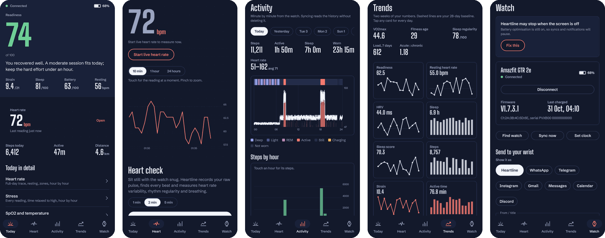
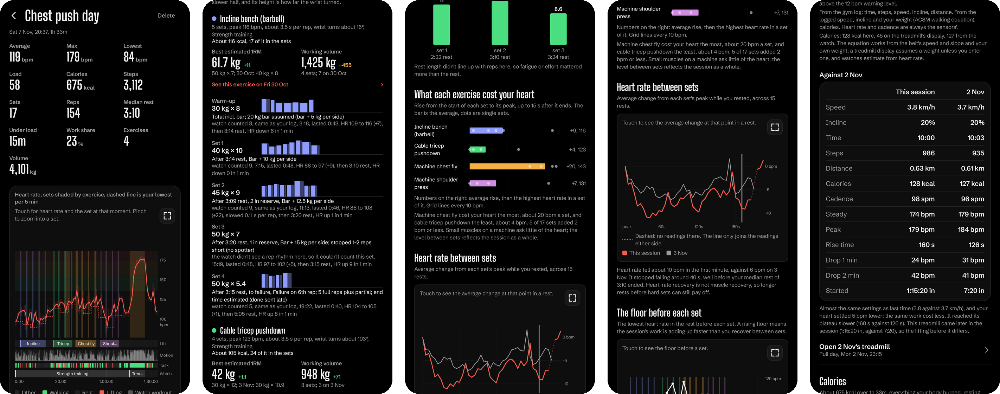
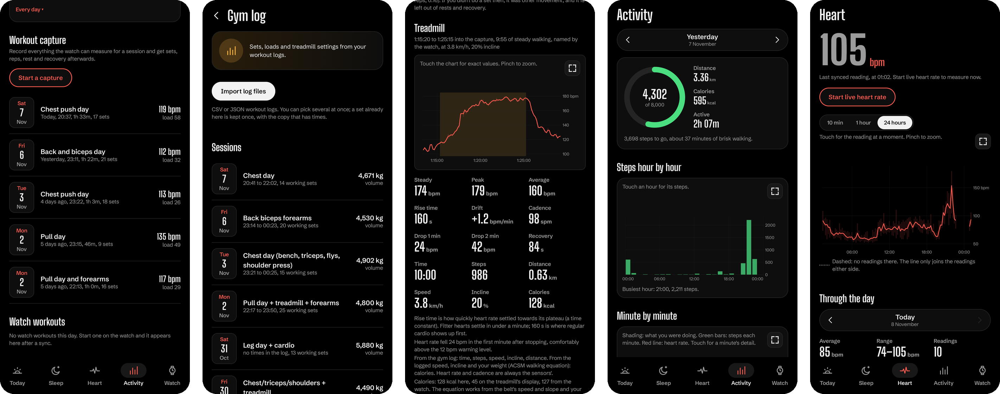

<p align="center">
  
</p>

<h1 align="center">Heartline: an open-source Zepp app alternative for the Amazfit GTR 2e</h1>

<p align="center">
  <b>Your watch, minus the Zepp app, plus a gym coach and an AI assistant.</b><br>
  Heartline talks to the <b>Amazfit GTR 2e</b> directly over Bluetooth LE and keeps every reading on your phone:
  heart rate, sleep stages and naps, SpO2, stress, HRV, skin temperature, notifications, alarms and weather. It
  records your gym sessions from the watch's raw sensors, merges them with your workout log and analyses every set,
  rest and calorie. Press the watch's Alexa button and ask it anything. No account, no cloud.
</p>

<p align="center">
  <a href="https://github.com/AbhiramJayasankar/heartline-zepp-alternative/releases/latest"></a>
  
  
  <a href="LICENSE"></a>
</p>

> **Status: 0.3.1.** Built and used daily on one Amazfit GTR 2e (firmware V1.7.3.1) with a Samsung Galaxy S24 Ultra.
> Other Huami/Zepp watches of the same generation (GTR 2, GTS 2, GTS 2e) speak a similar protocol but are untested.

## Highlights

| | |
|---|---|
| 🏋️ **A gym session analysed like a coach would** | Your log's sets and loads plus the watch's raw sensors: new bests, volume against last time, what each exercise cost your heart, recovery between sets, calories per exercise, a treadmill comparison with your last walk, and an AI coach's note with the numbers to aim for next time. |
| 🎙️ **An Alexa button that knows you** | Ask about your sleep, stress or readiness and get an analysis of *your* data. Ask for the news and it searches the web. Set timers, alarms and reminders by voice. Free AI, your own keys. |
| 📊 **Health scores Zepp never showed** | Readiness, strain, sleep score and body battery every day, trends against your own 28-day baseline, VO2max and fitness age. |
| 🌙 **A page for every part of you** | Sleep with a stage-by-stage hypnogram and overnight SpO2, heart rate with resting and HRV against your usual, activity against your goal, and an overview that ties them together. |
| ✨ **AI insights** | The model you choose reads two weeks of your data and writes what stands out, with the numbers and one thing to try. |
| 🧠 **Your AI, your models** | Gemini, OpenRouter or any OpenAI-compatible API, as many keys as you like. Every AI feature gets a main model and two fallbacks, and an out-of-quota key hands over to the next. |
| 🎨 **Seven themes** | Paper, Night, Sage, Dusk, Lilac, Forest and a true-black OLED theme, or follow the phone. |
| 🫀 **Heart checks from the raw pulse** | Records the optical pulse waveform and measures HRV, rhythm regularity and breathing rate beat by beat. |
| 🔬 **Every sensor, raw** | Live pulse, accelerometer, gyroscope, compass, GPS and microphone streams, saved to CSV. |
| ⌚ **Everything Zepp did** | Notifications with app icons, calls, music, find phone, alarms, calendar reminders, weather, watch settings and the app list. |
| 🔒 **No account, no cloud** | One local database on the phone. Export it, back it up, or share it through Health Connect. |

## Gym sessions, analysed like a coach would

<p align="center">
  
</p>

Start a capture on the phone (or ask the watch's Alexa button), train, and import your workout log afterwards.
Heartline lines the log up with what the watch's accelerometer, gyroscope and heart-rate sensor recorded:

- **One chart for the whole session**: heart rate with every set shaded by exercise, your rising heart-rate floor,
  zones, and lanes underneath for each exercise, wrist motion, what you were doing and the watch's own workouts, all
  on one time axis. Touch any moment for the set, the heart rate and the **calories so far**.
- **What stood out**: new bests by estimated one-rep max, volume against the last session with the same exercises,
  the exercise that cost your heart most, recovery against last time, sets taken to failure, skipped sets.
- **Every exercise and set**: rest before, reps in reserve, failure and difficulty from your log; reps counted by the
  watch, each rep's duration and wrist arc; a link to the same exercise last session.
- **Calories every 5 seconds**: heart-rate reserve converted to oxygen use with your VO2max and weight, the ACSM
  walking equation for a logged treadmill stretch, and the watch's own estimate met halfway. Per exercise, per part
  of the session, and a running total.
- **The treadmill against your last walk**: speed, incline, time, steps, distance, calories, steady heart rate,
  rise time and recovery side by side, with a verdict ("same settings, your heart settled 5 bpm lower") and a link.
- **An AI coach's note** (the model you choose, your own key) that reads the page's numbers and says what to aim for next
  session, saved with the session.
- **Around the session**: readiness and sleep going in, the day's load, the heart check after, and the watch's
  workout beside what the sensors measured.

<p align="center">
  
</p>

## The Alexa button, rebuilt

On the GTR 2e, Alexa only works through the Zepp app and an Amazon account. Heartline catches the button press instead, listens through the watch's
microphone, and answers on the watch's own Alexa screens: text, cards, tables, alarms and timers.

| Say | What happens on your wrist |
|---|---|
| "How did I sleep last night?" | It reads your sleep stages and gives a short verdict on how you slept |
| "Analyse my heart rate today" | It pulls the day's heart rate, resting rate and zones and tells you what stands out |
| "What's the weather like?" | The watch's weather card for where your phone is: now, today and three days |
| "Who won the last F1 race?" | It searches the web (Tavily or Exa) and answers from what it finds |
| "List the ten tallest mountains" | A scrolling two-column table on the watch |
| "Remind me to drink water in 20 minutes" | The reminder rings on the watch with its title; "cancel my water reminder" cancels it |
| "Wake me at 6:30" / "Timer for 5 minutes" | A real watch alarm or timer, set on the watch itself |
| "Start a gym workout" | Heartline's workout capture starts recording sets and reps |
| "Tell me a 5,000-word story" | The reply screen shows the start; the whole story arrives as watch notifications |
| "Do deep research on this week's AI news" | It searches as long as it needs; if the watch can't wait, it says so and the report arrives as notifications |
| "Tell me a knock-knock joke" | It plays along: the watch listens again after each line |

- **Listens until you stop talking**, up to 29 seconds for a detailed question, and ignores the room's background
  sounds when deciding you've finished.
- **Hears you with Gemini 3.5 Transcribe Live** by default (free tier), or any model that takes audio, tuned for
  Indian and US English.
- **Thinks with the model you choose** (free OpenRouter models, Gemini, or any OpenAI-compatible API) and 20 tools:
  eight health-data lookups, web search, and actions for timers, alarms, reminders, workouts, the weather card,
  tables and syncing. It can take up to 25 requests and 15 minutes for a thorough answer.
- **Follow-ups when they're needed**: the model ends a reply with a tag when it needs your answer, and the watch
  reopens its mic with the question on screen.
- **Built around the watch's real limits**, measured on the device: 2,000-byte replies, 1,024-byte notifications, a
  10-character left column in tables, and a map of the emoji its font actually draws, so you never see a box.
- **Nothing hidden.** The app's Alexa page logs every question: what was heard, each model request with its
  timing and tokens, every tool call with its arguments and result, the reply, and the recording to play back. You
  can edit the instructions, switch tools on and off, rewrite their descriptions, and pick the models, reasoning
  and limits. "Try a question" runs the whole pipeline without touching the watch.

## Everything else

**Health and sleep**
- **Readiness, strain, sleep score and body battery** each day, with a short plain-language suggestion, and a
  Readiness page that shows exactly how the number was worked out.
- **Naps** are kept apart from nights, shown on the Sleep page and Today, and recharge body battery.
- **Automatic HRV**: samples overnight while you sleep and during still moments in the day.
- **Heart rate** all day (per-minute history plus live readings), sleeping and awake resting heart rate, and zones.
- **Sleep page**: a hypnogram of the night, each stage against its typical range, heart rate and SpO2 while asleep,
  two weeks of nights, sleep score and how regular your timing is.
- **SpO2, stress, PAI and skin temperature.** Temperature is a reading every minute, synced every 5 minutes.
- **Trends**: two weeks of readiness, resting HR, HRV, sleep, steps, strain and active time against your 28-day
  baseline, plus **VO2max, fitness age** and acute:chronic training load.

**Heart checks from the raw pulse**
- Records the watch's raw PPG waveform, finds every beat and measures **HRV (RMSSD), rhythm regularity and
  breathing rate**. Rhythm screening is a hint, not a diagnosis.

**Workouts**
- Imports the watch's own workouts with per-second heart rate and GPS routes.
- **Gym workout capture**: streams raw accelerometer, gyroscope and pulse during a session and finds your
  **sets, reps, rest times, heart-rate recovery, zones, load and calories**, tuned on real logged gym sessions.
- **Gym log import** (CSV or JSON, [format](docs/GYM_LOG_FORMAT.md)): sets, loads, reps in reserve and treadmill
  settings merge into the capture; treadmill walks give a VO2max estimate.

**Watch control, like Zepp**
- **Phone notifications** on your wrist (per-app icons), incoming calls, find phone, music control.
- **Watch settings**: all-day heart rate and stress monitoring, lift-to-wake (scheduled), do not disturb
  (scheduled), move reminders, high heart rate alerts, disconnect alert, language, wrist, step goal and more.
- **Watch app list**: choose and order the apps, and what goes in the More screen.
- **Alarms, calendar reminders, weather** for where your phone is (Open-Meteo, no API key), vibration counts, set
  clock, find watch.

**AI insights**
- The model you choose under AI models, with its fallbacks. Two weeks of readiness, trends, sleep, heart rate,
  activity, stress, SpO2, temperature and gym captures go in; ranked findings with the numbers and one thing to try
  come out. Nothing is sent until you ask: daily insights are off unless you switch them on in the page's settings.

**AI models**
- **Providers and keys**: OpenRouter, Gemini and any OpenAI-compatible endpoint (Groq, Together, a local server),
  each with as many keys as you like. A key that runs out of quota or is refused rests for 30 minutes and the next
  one takes over.
- **Models to choose from**: fetch every provider's model list and tick the few you want offered.
- **Every AI feature** (watch assistant, voice to text, insights, coach's note, workout names) gets a main model and
  two fallbacks. Out of quota means the next key, then the next model; busy or timed out means the same model again.
  Retries, waits and time limits are yours to set per feature.
- **Every request is logged** with its model, key, time and any error.

**Your data stays yours**
- Everything is stored in a local database on the phone. Export it, back it up, or share it with other apps through
  **Health Connect** (heart rate, steps, sleep, SpO2, HRV, resting HR, skin temperature, workouts).
- **Sensors lab**: live raw pulse, motion, compass, GPS and microphone, saved to CSV.

## Download

Get the APK from the [latest release](https://github.com/AbhiramJayasankar/heartline-zepp-alternative/releases/latest)
and open it on your phone, or install it with `adb install -r heartline-*.apk`.

## Set up

1. **Get your watch's auth key.** The watch only talks to apps that know its 32-character key. Fetch it from your Zepp
   account with [huami-token](https://github.com/argrento/huami-token) (or Amazfit Watchface Maker).
   Keep it private.
2. **Never unpair the watch in Zepp.** Unpairing changes the key. Instead, force-stop Zepp (or uninstall it):
   the watch accepts one connection at a time.
3. Open Heartline, grant Bluetooth and notification access, and enter the watch's Bluetooth address and key.
   The key is stored encrypted with the Android keystore and never leaves the phone.
4. Under **Watch → Keep running**, allow background use so syncing continues with the screen off.
5. **For the AI features**, open **Watch → AI models**, add a [Gemini](https://aistudio.google.com) key and an
   [OpenRouter](https://openrouter.ai) key (both have free tiers), fetch their model lists and pick the models each
   feature uses. Under **Watch → Alexa**, a [Tavily](https://tavily.com) or [Exa](https://exa.ai) key adds web search
   (1,000 free searches a month on Tavily).

## Requirements

| | |
|---|---|
| Watch | Amazfit GTR 2e (tested on firmware V1.7.3.1). GTR 2 / GTS 2 family: untested |
| Phone | Android 12 or newer (arm64). Tested on a Galaxy S24 Ultra, Android 17 |
| Build | JDK 17+, Android SDK platform 37 |

## Build from source

```bash
git clone https://github.com/AbhiramJayasankar/heartline-zepp-alternative.git
cd heartline-zepp-alternative/android
./gradlew assembleDebug        # app/build/outputs/apk/debug/app-debug.apk
./gradlew test                 # unit tests, including real recorded sessions
```

## How it works

Heartline speaks the watch's Bluetooth LE protocol directly: the Huami authentication handshake, the activity and
health history fetches (without the acknowledgement that would delete data from the watch), the 2021 chunked
protocol used by the Alexa button, and the raw sensor stream. The protocol notes are in
[`android/docs/`](android/docs) (the Alexa bridge in [`alexa-bridge.md`](android/docs/alexa-bridge.md)) and the
analysis methods in [`android/core/analytics/`](android/core/analytics) and
[`server/analytics/METHODS.md`](server/analytics/METHODS.md).

| Folder | What it is |
|---|---|
| `android/app` | The Heartline Android app (Kotlin, Jetpack Compose), including the Alexa assistant |
| `android/core/protocol` | Watch protocol: commands, history parsing, settings, Alexa, event log |
| `android/core/ble` | Bluetooth LE connection, sync and raw streaming |
| `android/core/analytics` | Readiness, sleep, HRV, rhythm, workout capture (sets and reps) |
| `android/core/data` | Local SQLite storage, export, encrypted key store |
| `server/`, `web/` | A Python (FastAPI + bleak) desktop dashboard that talks to the watch from a PC |
| `research/` | The first protocol exploration scripts (bleak, Windows) |

## Good to know

- **Some data is handed over once.** After Heartline syncs skin temperature, stress, SpO2 and the event log, the watch
  moves past those records, so Zepp won't get them. Activity, heart rate, PAI and workouts stay on the watch.
- **Not supported:** watch faces, firmware updates and world clocks. Vibration *patterns* don't change on the
  GTR 2e; the count does.
- **Automatic workout capture** can start up to about 30 minutes late, because the watch reports workout starts
  in batches. For a whole gym session, start the capture in the app.
- **The Alexa button needs the internet** and your own keys; free models are sometimes slow or rate-limited. The
  watch waits about 30 s after you stop talking, so after 25 s it's told the answer is coming, and the answer
  arrives as notifications.
- **Alexa alarms and reminders** made by voice can't be deleted from the phone (the watch ignores it); long-press
  them in the watch's Alarm app.
- Heart rhythm screening and all health scores are estimates for personal use, not medical advice.

## FAQ

**Can I use an Amazfit watch without the Zepp app?**
Yes. Heartline replaces Zepp for the Amazfit GTR 2e: syncing, settings, notifications and the Alexa button all
work without a Zepp account or cloud connection once you have the watch's auth key.

**Does the Alexa button work without Amazon?**
Yes. Heartline answers it instead of Alexa, with the speech and answer models you choose (Gemini, OpenRouter or any
OpenAI-compatible API). No Amazon account is involved.

**How is this different from Gadgetbridge?**
[Gadgetbridge](https://gadgetbridge.org) supports hundreds of watches and was a key reference for the protocol.
Heartline does one watch in depth: it decodes the watch's skin temperature, event log and raw sensor streams, adds
health scores, heart checks from the raw pulse, gym set and rep detection, and an AI assistant on the Alexa button.

**Does it need the internet?**
No. Only optional features go online: weather (Open-Meteo) and the AI features (the models you choose, through your
own keys, and Tavily or Exa to search).

**Will it work on my GTR 2, GTS 2 or GTS 2e?**
Probably in large part, since they share the protocol, but only the GTR 2e has been tested. Reports are welcome
in the [issues](https://github.com/AbhiramJayasankar/heartline-zepp-alternative/issues).

## Credits

Protocol knowledge from [Gadgetbridge](https://codeberg.org/Freeyourgadget/Gadgetbridge); auth keys via
[huami-token](https://github.com/argrento/huami-token); weather from [Open-Meteo](https://open-meteo.com); speech
and answers from [Gemini](https://ai.google.dev), [OpenRouter](https://openrouter.ai) or any OpenAI-compatible API; search from
[Tavily](https://tavily.com) and [Exa](https://exa.ai). Not affiliated with Zepp Health, Amazfit or Amazon.

## License

[MIT](LICENSE)
